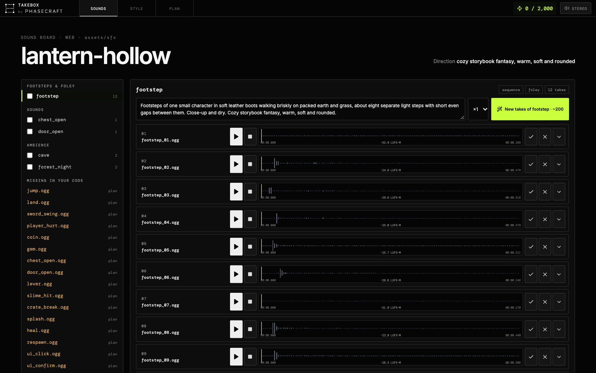
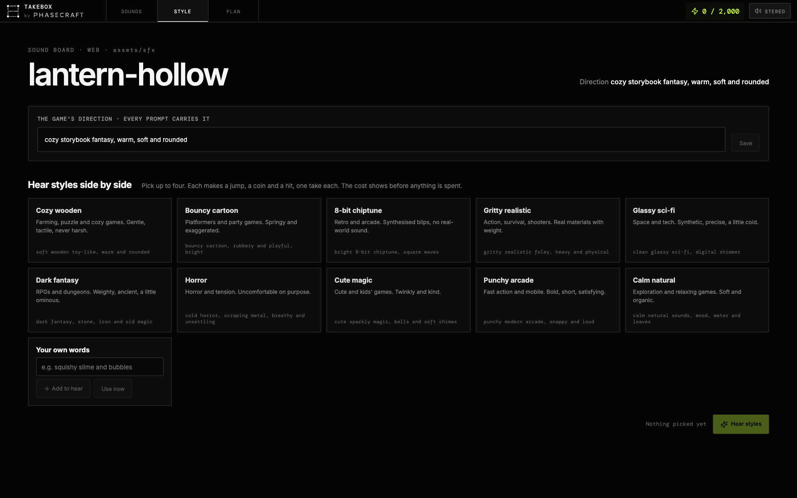
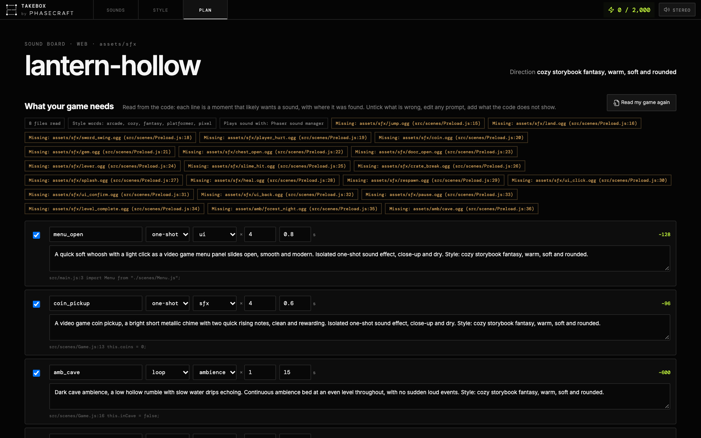

# TAKEBOX MCP

**Sound for your game, made the way a sound designer would, by the AI you already code with.**



You are making a game with an AI assistant. The game is silent, or it has a few sounds that do not
fit together. TAKEBOX gives your AI the skills of a sound designer. It reads your game, lists every
sound it needs, makes them with ElevenLabs on your own account, and hands back files that are ready
to play: trimmed so they fire instantly, levelled so they sit together, looped without a click,
named in order, in your engine's format. Then your AI wires them into the code.

TAKEBOX runs on your own computer. It has no account, no sign-in, no server of its own and no
telemetry. Your key and your sounds stay on your machine. The only thing that leaves it is the
request you approve to ElevenLabs.

## Start here (no coding needed)

You need three things: Node.js, an ElevenLabs key, and an AI coding tool such as Claude Code, Cursor,
Windsurf or Claude Desktop.

**1. Install Node.js.** Go to [nodejs.org](https://nodejs.org), download the LTS installer and run it.
Version 20 or newer works.

**2. Get an ElevenLabs key.** Make an account at [ElevenLabs](https://try.elevenlabs.io/takebox-mcp).
*That is an affiliate link. Ryu, who makes TAKEBOX, is an independent affiliate of ElevenLabs and may
receive a commission if you subscribe through it.* In ElevenLabs open **Developers**, then **API keys**,
and create a key. Copy it. If you limit what the key can do, allow Sound Effects and reading User.

**3. Add TAKEBOX to your AI tool.** Pick yours.

*Claude Code.* Open a terminal in your game's folder and paste this, with your key in place of
`your_key`:

```bash
claude mcp add takebox -e ELEVENLABS_API_KEY=your_key -- npx -y @phasecraftaudio/takebox-mcp
```

*Claude Desktop.* Open **Settings**, then **Developer**, then **Edit Config**. A file named
`claude_desktop_config.json` opens. Paste the block below into it and save. Then quit Claude Desktop
completely and open it again. A change to this file is only read at start.

*Cursor.* Open **Settings**, find **MCP** (it may sit under Tools), and add a new server. A file named
`mcp.json` opens. Paste the block below into it and save.

*Windsurf.* Open **Settings**, find the MCP servers under Cascade, and open the raw config. Paste the
block below into it, save, and refresh the list.

The block is the same for all three. Put your key and the path to your game's folder in the two
marked places. If the file already has an `mcpServers` part, add only the `takebox` entry inside it.

```json
{
  "mcpServers": {
    "takebox": {
      "command": "npx",
      "args": ["-y", "@phasecraftaudio/takebox-mcp"],
      "env": {
        "ELEVENLABS_API_KEY": "your_key",
        "TAKEBOX_PROJECT": "/path/to/your/game"
      }
    }
  }
}
```

**Check that it is connected.** Ask your AI:

> Is TAKEBOX connected? Run its setup.

It should answer with your game's folder and engine. If it says it has no TAKEBOX tools, the config
was not read. Check the file saved, check the brackets and commas, and restart the app.

Not sure where those settings are? Give your AI the link to this page and ask it to set TAKEBOX up.
Type the key in yourself.

**4. Ask for sound.** In your AI tool, with your game open, say:

> Do a full sound pass on this game.

It reads the game, shows you the list of sounds and what they will cost, and waits for your yes
before it spends anything.

**5. Listen and choose.** Say:

> Open the sound board.

A page opens in your browser. Play every take, keep the good ones, reject the rest, and ask for new
takes of anything that is not right. Your AI uses what you kept.

### What it costs

TAKEBOX is free. The sounds are made on your ElevenLabs account and use its credits, about 40 for
each second of sound. The test game in these pictures got its first five sounds for 390 credits.
Every spend shows its cost first and waits for your yes. A daily cap (2,000 credits unless you change
it) stops a runaway batch. Check ElevenLabs' plans for what each one lets you ship in a game.

Made and tested on macOS. Windows and Linux are not tested yet.

## What the agent can do

| Tool | What it does | Costs credits |
|---|---|---|
| `setup` | Shows the project, engine, folder, formats this machine can write, the account, today's spend. Saves the game's sound direction. | no |
| `plan_sounds` | Reads the code: game moments with file:line evidence, audio files the code expects but are missing, how the game plays sound, style words. Drafts a prompt for each from TAKEBOX's researched templates. Returns the sound design guide. | no |
| `search_sounds` | Finds a sound already made, anywhere in the project, or in your own sound library (UCS names understood). | no |
| `make_sounds` | Generates a batch, then finishes every take. Estimates first; asks you above a line; stops at a daily cap. | yes |
| `finish_sounds` | Trim, loop, split, level, convert files that exist: your library files, or re-finishing made sounds from their kept originals. | no |
| `analyze_sounds` | Measures loudness, true peak, late starts, long tails, clipping, fake stereo, clicking loops, and compares levels across the set. | no |
| `audition_styles` | The same jump, coin and hit in up to four styles, one take each, so you pick a direction by ear. Shows its cost first. | yes |
| `open_board` | Opens the sound board in your browser. | no |

Plus the guide as a resource (`takebox://guide`) and a `sound_pass` prompt: one command that runs
the whole pass, asking you one question at a time.

## The sound board

TAKEBOX in your browser, on your machine only (`127.0.0.1`). Ask your AI to "open the sound board",
or without any AI:

```bash
npx -y @phasecraftaudio/takebox-mcp board /path/to/your/game
```

- **SOUNDS**: every sound in a sidebar, grouped (interface, footsteps, impacts, ambience, music),
  with any file your code asks for that does not exist yet. Pick one (or use the arrow keys) to see
  its takes, each with play, waveform and loudness. Keep, reject (moved to `.takebox/rejected`, never deleted), trim,
  split, loop, export a region. Edit a prompt and make new takes. Loops play gaplessly.
- **STYLE**: ten starting styles plus your own words. Hear up to four side by side, then use one;
  it becomes the game's direction.
- **PLAN**: what your game needs, read from its code, with where each moment was found. Untick,
  edit, add your own, then make them all at once.





Every spend shows its cost and waits for your yes. The board answers only its own page: a session
token in an HttpOnly cookie, its own Origin, no framing by other sites. The take cards are TAKEBOX desktop's own
(`src/WaveformCard.tsx`), so the board and the app behave the same. What you keep is written to
`takebox.json`, and the AI wires those takes in. The board follows `takebox.json`, so sounds the
AI makes appear while it is open.

## Install, in detail

**Claude Code**, from your game's folder:

```bash
claude mcp add takebox \
  -e ELEVENLABS_API_KEY=your_key \
  -e TAKEBOX_LIBRARY=/path/to/your/sound/library \
  -- npx -y @phasecraftaudio/takebox-mcp
```

Claude Code adds TAKEBOX to the git repo your folder is in, not the folder alone. If your game is
one folder of a bigger repo, also pass `-e TAKEBOX_PROJECT=/path/to/your/game`, so TAKEBOX reads,
plans and writes for the game and not the whole repo.

**Cursor / Windsurf / Claude Desktop** use the JSON under Start here. Add any setting below to its
`env` block, for example `"TAKEBOX_DAILY_CREDITS": "2000"`.

Without a key everything works except making new sounds.

### Settings (environment, set by you, never by the agent)

| Variable | Default | Meaning |
|---|---|---|
| `ELEVENLABS_API_KEY` | none | Your key. Without it everything works except `make_sounds`. |
| `TAKEBOX_PROJECT` | the client's workspace, else the current folder | The game's folder. TAKEBOX refuses your home folder. |
| `TAKEBOX_LIBRARY` | none | Sound library folders, separated by `:` (`;` on Windows). |
| `TAKEBOX_DAILY_CREDITS` | 2000 | Hard cap per day across all projects and processes. A batch holds its estimate before it starts, so two at once cannot pass it together. `off` for none. |
| `TAKEBOX_ASK_ABOVE` | 300 | A batch above this needs your yes. |
| `TAKEBOX_FFMPEG` | auto | A specific ffmpeg, for FLAC / Opus / M4A. |
| `TAKEBOX_HOME` | `~/.takebox` | Where the spend ledger lives. |

## Formats

Built in, no ffmpeg needed:

| | WAV 16/24/32f | AIFF | MP3 | OGG Vorbis | Opus | FLAC | M4A/AAC |
|---|---|---|---|---|---|---|---|
| read | ✓ | ✓ | ✓ | ✓ | ✓ | ✓ | with ffmpeg |
| write | ✓ | ✓ | ✓ | ✓ | with ffmpeg | with ffmpeg | with ffmpeg |

With TAKEBOX desktop installed, its LGPL ffmpeg adds FLAC. A full system ffmpeg adds Opus and M4A.
`setup` says what this machine can write.

Defaults by engine: **web** OGG (every current browser; add MP3 for iPhones older than iOS 18.4) ·
**Godot** WAV for one-shots, OGG for loops · **Unity / Unreal** WAV (they compress on import).
MP3 is never used for loops: its encoder delay ticks on every repeat.

## What happens to a sound

1. **Generate** at 48 kHz WAV (no MP3 decoding, no encoder delay). The original is kept in
   `.takebox/originals/`, so any later change is free.
2. **Shape**: one-shots are trimmed (latency off the head, dead air off the tail, fades only where
   cut); sequences are split into separate hits; loops are made seamless. These are TAKEBOX desktop's
   own tools (`server/takeTools.ts`).
3. **Level**: one gain to the role's target, held back to stay under −1 dBTP. No compression, no EQ.
4. **Write** every requested format, numbered `name_01`, `name_02`…, never overwriting.
5. **Record** in `takebox.json`, which the agent reads to wire the files in.

Role targets (starting points, to be checked by ear in a real game): ui −20, foley −21, sfx −18,
impact −14 LUFS on the loudest 400 ms; ambience −27, music −20, voice −20 LUFS integrated.

## Development

```bash
npm install                  # at the top of the repo: Vite and React, which build the board
cd mcp && npm install
npm test                     # no network, no credits
npm run typecheck
npm run build                # dist/takebox-mcp.js and dist/board/
```

The package lives in `mcp/`. It imports `../shared/dsp/*`, `../shared/gameTemplates.ts` and
`../server/takeTools.ts`, and the board imports `../src/WaveformCard.tsx`, `../src/PhasecraftMark.tsx`,
`../src/styles.css` and `../public/`. Those files are TAKEBOX desktop's own, so the desktop app and
this server cut, loop and level the same way.

Found a bug or want something? Open an issue on GitHub.

### Third-party code

MCP TypeScript SDK and zod (MIT). Decoders: eshaz's wasm-audio-decoders (MIT wrappers; mpg123
LGPL-2.1; libvorbis, libopus, libFLAC BSD). Encoders: wasm-media-encoders (MIT wrapper; LAME
LGPL-2.0; libvorbis BSD). Each codec is a separate WebAssembly module, replaceable as the LGPL asks.
The board page carries React, wavesurfer.js, Lucide and the Inter and DM Mono typefaces; their
licences ship with it in `dist/board/licences.txt`.

## TAKEBOX and ElevenLabs

ElevenLabs and the ElevenLabs logo are registered trademarks or trademarks of ElevenLabs, Inc. Used
with permission. TAKEBOX is not sponsored by, endorsed by, or affiliated with ElevenLabs except as an
independent participant in the ElevenLabs Creator Affiliate Program. TAKEBOX is an independent tool
that works with the ElevenLabs API on a key you supply.

## Licence

Apache-2.0 (see `LICENSE` and `NOTICE`). The TAKEBOX and PHASECRAFT names, logos and wordmarks are
not licensed with the code: a fork may use the code freely, but must not present itself as TAKEBOX
or PHASECRAFT.
